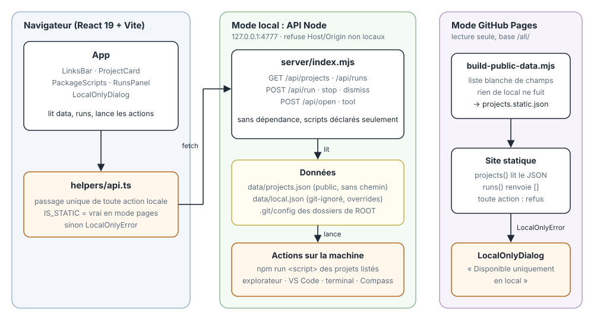

# all

Tableau de bord de tous mes projets : repos GitHub, ressources externes (MongoDB Atlas, Firebase, Vercel...), acces au dossier local et lancement des scripts npm.

React + TypeScript + Vite + Tailwind + ESLint, plus une petite API Node locale (`server/index.mjs`).

**Version en ligne : https://mathieujullien77190.github.io/all/**

Sur GitHub Pages, seule la liste des projets et des liens est disponible. Tout ce qui se lance en local (dossier, VS Code, terminal, Claude, scripts, Compass) ouvre une fenetre "Disponible uniquement en local".

## Lancer

```
npm install
npm run dev
```

- front : http://localhost:5173
- API locale : http://127.0.0.1:4777 (ecoute uniquement sur localhost)

## Raccourci bureau

```
npm run shortcut
```

Crée `all.lnk` sur le bureau (icône : anneau d'or). Il lance `scripts/launch.ps1` : installe les dépendances
au premier lancement, démarre le front + l'API, puis ouvre la page dans le navigateur. Si le dashboard tourne
déjà, il ouvre juste la page.

## Config

- `data/projects.json` : projets, liens, ressources. A modifier pour ajouter un projet. Aucun chemin local dedans (repo public).
- Les dossiers locaux sont retrouves automatiquement : l'API scanne les sous-dossiers de `PROJECTS_ROOT` et associe chacun au projet dont le repo correspond a son remote `origin` GitHub.
- `data/local.json` (git-ignore, optionnel) : `{ "<id projet>": "<chemin>" }` pour un repo clone hors de `PROJECTS_ROOT`.
- Les scripts npm sont lus en direct depuis chaque `package.json`.
- `PROJECTS_ROOT` : dossier racine des projets (defaut : le dossier parent de ce repo).
- `MONGO_COMPASS_PATH` : chemin de MongoDBCompass.exe si installe ailleurs que `%LOCALAPPDATA%\MongoDBCompass`.
- Le bouton Compass lit `MONGODB_URI` dans le `.env.local` du projet `books` (jamais envoye au navigateur ni commite).

## Architecture



Toute action locale passe par `src/helpers/api.ts` : en local elle appelle l'API Node, sur GitHub Pages elle leve `LocalOnlyError`.

## Securite

L'API n'execute que les scripts declares dans les `package.json` des projets listes, refuse les requetes dont le Host/Origin n'est pas localhost, et ne sert aucun secret.

## GitHub Pages

`npm run build:pages` genere `public/projects.static.json` (liste blanche de champs, voir `scripts/build-public-data.mjs`) puis build Vite en mode `pages` (base `/all/`). Le workflow `.github/workflows/pages.yml` le deploie a chaque push sur `main` (Settings > Pages > Source : GitHub Actions).
